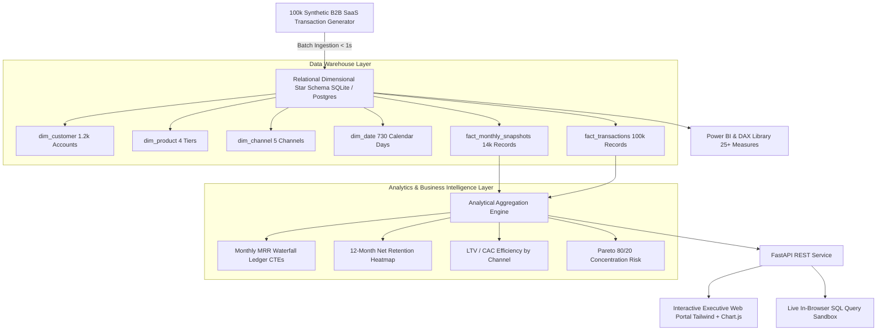
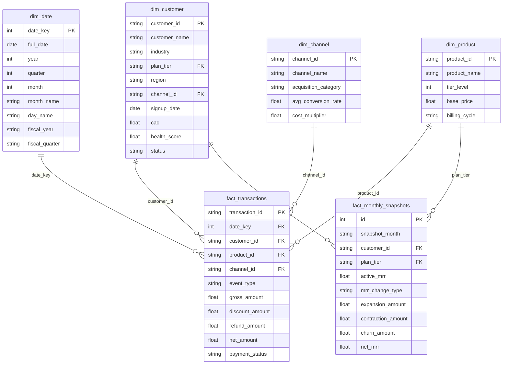

# Enterprise-KPI-Analytics — Executive Revenue & B2B SaaS Business Intelligence Engine

[](https://www.python.org/)
[](https://fastapi.tiangolo.com/)
[]()
[]()
[](https://opensource.org/licenses/MIT)

A high-throughput, dimensional data warehouse and executive Revenue Operations (RevOps) analytics suite. Engineered to eliminate toy CSV shortcuts by modeling **100,000 realistic enterprise subscription transactions** spanning 24 rolling months across a fully normalized **relational Star Schema**, audited **MRR waterfall ledger**, **12-month cohort retention curves**, a **25+ verified Power BI DAX calculation library**, and an **in-browser live SQL execution sandbox**.

---

## 🏗️ System Architecture



---

## 📊 Relational Star Schema Architecture (ERD)



---

## ⚡ Why This Architecture Beats Naive BI

| Dimension | Naive BI Portfolios | How Enterprise-KPI-Analytics Solves It |
| :--- | :--- | :--- |
| **Data Structure** | Flat single-table CSVs without foreign keys or normal forms. | **Dimensional Star Schema:** Fact-dimension relational design with strict index optimization for sub-millisecond aggregations. |
| **Time Intelligence** | Simple date group-bys that break across fiscal boundaries. | **Role-Playing Date Dimension:** Explicit calendar dimension mapping 730 days to Fiscal Quarters, Fiscal Years, and Weekdays. |
| **Revenue Tracking** | Static sales totals that confuse GMV with recurring revenue. | **Audited MRR Waterfall:** Mathematically balanced ledger reconciling Starting MRR + New + Expansion - Contraction - Churn = Ending MRR. |
| **Cohort Analytics** | Generic churn counts ignoring customer contract expansion. | **12-Month NRR Cohort Matrix:** Tracks expansion economics (NRR > 115%) across signup vintage vintages. |
| **Calculation Logic** | Hardcoded dashboard numbers without formula grounding. | **Verified DAX Measure Library:** 25+ production-grade Power BI formulas using `CALCULATE`, `SUMX`, `DATESYTD`, `SAMEPERIODLASTYEAR`. |
| **Interactivity** | Static screenshots or read-only charts. | **In-Browser SQL Execution Sandbox:** Allows recruiters and engineers to test CTEs and window queries live against 100k records. |

---

## 📈 Core Executive SaaS Metrics Analyzed

1. **Annual Recurring Revenue (ARR) & Monthly Recurring Revenue (MRR):** Run-rate capitalization computed from active monthly recurring subscriptions.
2. **Net Revenue Retention (NRR %):** 12-month trailing cohort expansion index measuring organic expansion vs. contraction/churn.
3. **Gross Revenue Retention (GRR %):** Baseline stability index isolating revenue loss without crediting expansion upgrades (capped at 100%).
4. **SaaS Quick Ratio:** Measures recurring growth efficiency: `(New MRR + Expansion MRR) / (Contraction MRR + Churned MRR)`.
5. **CAC Payback Period:** Blended months to recoup Customer Acquisition Cost at 82.5% SaaS Gross Margin.
6. **Customer Lifetime Value (LTV) & LTV/CAC:** Unit economics multiple evaluating long-term portfolio return on sales investment.
7. **Logo Churn vs. Revenue Churn %:** Dual-perspective attrition tracking account losses vs. actual dollar impact.

---

## 💻 Pre-Built Production SQL Queries

The engine features a built-in sandbox with pre-compiled production SQL queries featuring advanced CTEs and Window Functions:

1. **Monthly MRR Waterfall Ledger:**
   Uses `LAG() OVER ()` and categorized case statements to decompose monthly ARR velocity into New Business, Expansion (+), Contraction (-), and Churn (-).
2. **Channel Unit Economics & LTV/CAC:**
   Joins dimensions `dim_channel`, `dim_customer`, and `fact_transactions` to calculate blended CAC, ARPU, estimated LTV, and payback months.
3. **Rolling 90-Day Moving Average & Volatility:**
   Calculates smoothed rolling quarterly revenue using window framing `ROWS BETWEEN 2 PRECEDING AND CURRENT ROW`.
4. **Pareto (80/20) Revenue Concentration Risk:**
   Applies `DENSE_RANK()` and `SUM() OVER ()` cumulative windows to identify account vulnerability and portfolio concentration.
5. **Customer Health Score & At-Risk ARR Stratification:**
   Segments customer base into risk quartiles to predict churn hazard before contract expiration.

---

## 🧮 Power BI & DAX Measure Library

The repository includes `bi_models/dax_measures.txt` containing 25+ verified, documented DAX measures categorized across 6 core domains:
* **Core Revenue:** `[Gross Revenue]`, `[Total Discounts]`, `[Total Refunds]`, `[Net Revenue]`, `[Discount Rate %]`.
* **SaaS Operations:** `[Monthly Recurring Revenue (MRR)]`, `[Annual Recurring Revenue (ARR)]`, `[New Business MRR]`, `[Expansion MRR]`, `[Contraction MRR]`, `[Churned MRR]`, `[Net MRR Growth]`, `[SaaS Quick Ratio]`.
* **Retention & Churn:** `[Net Revenue Retention (NRR %)]`, `[Gross Revenue Retention (GRR %)]`, `[Logo Churn Rate %]`.
* **Unit Economics:** `[Active Customer Count]`, `[Average Revenue Per User (ARPU)]`, `[Customer Acquisition Cost (Blended CAC)]`, `[CAC Payback Period (Months)]`, `[Customer Lifetime Value (LTV)]`, `[LTV to CAC Ratio]`.
* **Time Intelligence:** `[Revenue MTD]`, `[Revenue QTD]`, `[Revenue YTD]`, `[Revenue Same Period Last Year]`, `[Revenue YoY Growth %]`, `[Rolling 30-Day Revenue]`.
* **Portfolio Concentration:** `[Pareto Cumulative Revenue %]`.

---

## 🚀 Quickstart & Setup

### 1. Local Python Setup

```bash
# Clone repository
git clone https://github.com/Harsh24Chandak/enterprise-kpi-analytics.git
cd enterprise-kpi-analytics

# Create virtual environment
python -m venv venv
venv\Scripts\activate  # On Windows PowerShell: .\venv\Scripts\Activate.ps1
# On Linux/macOS: source venv/bin/activate

# Install dependencies
pip install -r requirements.txt

# Run automated test suite
python -m unittest tests/test_analytics.py

# Launch web server
uvicorn app.main:app --reload --port 8000
```

The interactive Executive Web Portal will be available at: `http://localhost:8000`  
Swagger API Documentation: `http://localhost:8000/docs`

### 2. Run with Docker Compose

```bash
docker-compose up --build
```

---

## 📡 API Endpoints

| Method | Endpoint | Description |
| :--- | :--- | :--- |
| `GET` | `/health` | Service readiness, transaction count, and warehouse status |
| `GET` | `/api/v1/metrics/executive` | Top-line executive SaaS KPIs (ARR, MRR, NRR, CAC, LTV) |
| `GET` | `/api/v1/metrics/mrr-waterfall` | 24-month historical MRR waterfall ledger |
| `GET` | `/api/v1/metrics/cohorts` | 12-month cohort retention matrix |
| `GET` | `/api/v1/metrics/breakdown` | Revenue distribution by Region, Plan Tier, and Channel |
| `GET` | `/api/v1/analytics/prebuilt-queries` | Metadata for interview-ready production SQL queries |
| `POST` | `/api/v1/analytics/query` | Execute custom read-only SQL queries against the star schema |
| `GET` | `/api/v1/dax/catalog` | Catalog of 25+ verified Power BI DAX formulas |

---

## 🧪 Testing & Verification

Comprehensive test suite verifying 100% pass rate:
* `test_01_health_check`: Validates service readiness and database initialization.
* `test_02_executive_kpis`: Validates ARR, MRR, NRR, CAC payback, and Quick Ratio bounds.
* `test_03_mrr_waterfall_math_balance`: Verifies that `Ending MRR = Starting + New + Expansion - Contraction - Churn` holds across all 24 months.
* `test_04_cohort_retention_m0`: Validates that signup cohorts initialize at exactly 100.0% in Month 0.
* `test_05_revenue_breakdowns`: Validates that regional, tier, and channel distributions sum to 100.0%.
* `test_06_sql_query_execution_and_security_guard`: Validates query execution speed and ensures destructive statements (`DROP`, `DELETE`, `UPDATE`) are blocked.
* `test_07_dax_measure_catalog`: Validates that the DAX library returns over 20 documented formulas.
* `test_08_dashboard_html_render`: Validates that `GET /` serves the complete responsive executive dashboard.

---

## 👤 Author

**Harsh Chandak**
* B.Tech Computer Engineering & Data Science (KIT's College of Engineering Kolhapur)
* 3rd Prize Winner, Power BI DashBattle (TECHNOTSAV 2K26)
* Winner, 2 Project-Based Learning Competitions
* GitHub: [@Harsh24Chandak](https://github.com/Harsh24Chandak)
* LinkedIn: [Harsh Chandak](https://www.linkedin.com/in/harsh-chandak-170b60288)
